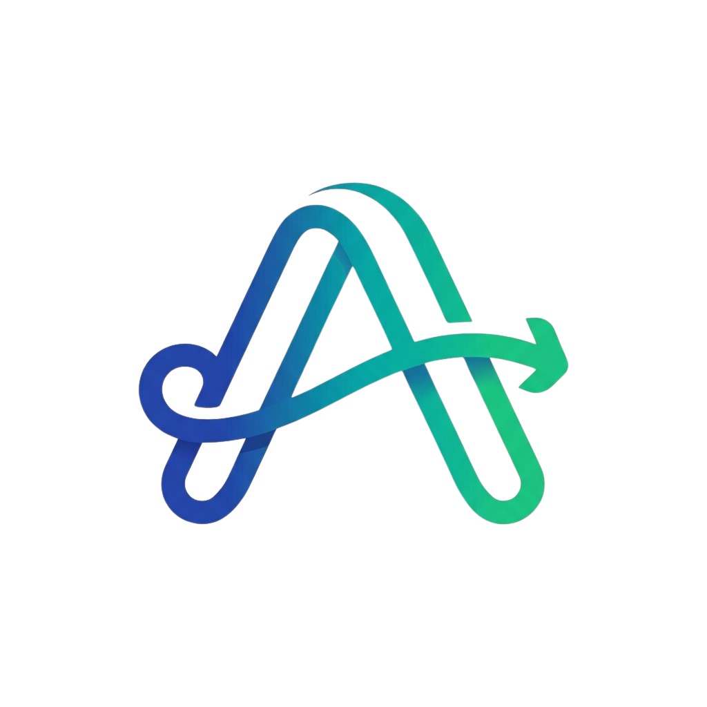
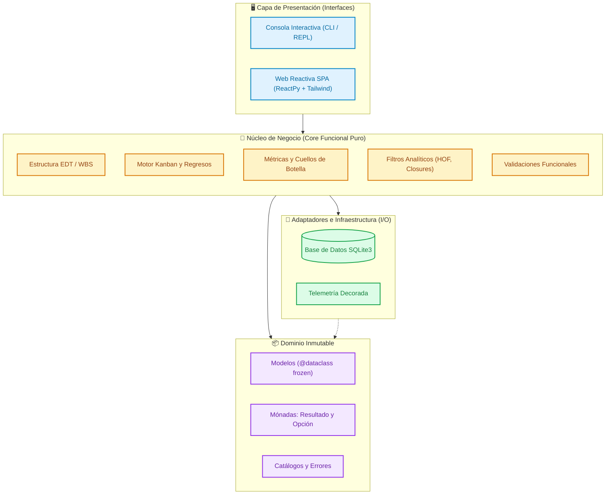

<div align="center">
  
  <h1>AgilBan</h1>
  <p><strong>Sistema Integral de Gestión Ágil Local (EDT + Tablero Kanban + Analítica)</strong></p>
  <p>Construido bajo los principios rigurosos de la <strong>Programación Funcional</strong> en Python, con soporte dual para interfaz de consola interactiva (CLI) y aplicación web reactiva (FastAPI + ReactPy + Tailwind CSS).</p>

  <p>
    
    
    
    
    
    
    
  </p>
</div>

---

## 📋 Tabla de Contenidos

- [Acerca del Proyecto](#-acerca-del-proyecto)
- [⚙️ Requisitos Previos e Instalación](#️-requisitos-previos-e-instalación)
- [🖥️ Guía de Ejecución Rápida](#️-guía-de-ejecución-rápida)
  - [⚠️ Paso Obligatorio: Activar el Entorno Virtual](#️-paso-obligatorio-activar-el-entorno-virtual)
  - [1. Modo Web Reactiva (FastAPI + ReactPy)](#1-modo-web-reactiva-fastapi--reactpy)
  - [2. Modo Consola Interactiva (CLI / REPL)](#2-modo-consola-interactiva-cli--repl)
  - [❓ Resolución de Problemas Comunes](#-resolución-de-problemas-comunes)
- [✨ Características Principales](#-características-principales)
- [🧠 Arquitectura de Software](#-arquitectura-de-software)
- [🔬 Los 10 Pilares de Programación Funcional](#-los-10-pilares-de-programación-funcional)
- [📂 Estructura del Proyecto](#-estructura-del-proyecto)
- [🧪 Calidad de Código y Pruebas](#-calidad-de-código-y-pruebas)
- [👥 Autores y Créditos](#-autores-y-créditos)

---

## 🚀 Acerca del Proyecto

**AgilBan** es una solución de gestión ágil diseñada para equipos que buscan estructurar y monitorear sus proyectos con precisión metodológica y alto rendimiento. Integra de forma natural la **Estructura de Desglose del Trabajo (EDT / WBS)** con la agilidad visual de un **Tablero Kanban de 4 columnas**, complementado con un motor analítico de detección de cuellos de botella y trazabilidad de retrabajos.

El proyecto destaca por su pureza arquitectónica: el núcleo del dominio y la lógica de negocio han sido modelados siguiendo estrictamente los principios de la **Programación Funcional**, aislando totalmente los efectos secundarios de entrada/salida y garantizando inmutabilidad, determinismo y seguridad de tipos.

---

## ⚙️ Requisitos Previos e Instalación

### Requisitos del Sistema:
* **Python 3.10 o superior** (Recomendado Python 3.11 o 3.12+)
* **Git**

### Instalación Inicial Paso a Paso:

1. **Clonar el repositorio:**
   ```bash
   git clone https://github.com/tu-usuario/AgilBan.git
   cd AgilBan
   ```

2. **Crear el entorno virtual:**
   ```bash
   # En Windows
   python -m venv .venv

   # En Linux / macOS
   python3 -m venv .venv
   ```

3. **Activar el entorno virtual:**
   ```bash
   # En Windows (PowerShell)
   .venv\Scripts\activate

   # En Windows (CMD)
   .venv\Scripts\activate.bat

   # En Linux / macOS
   source .venv/bin/activate
   ```

4. **Instalar dependencias del proyecto:**
   ```bash
   pip install -r requirements.txt
   ```

---

## 🖥️ Guía de Ejecución Rápida

### ⚠️ ¡Paso Obligatorio: Activar el Entorno Virtual!

> **¡ATENCIÓN!**
> Siempre que abras una nueva ventana de terminal o regreses al proyecto tras haber cerrado tu editor/computadora, **debes reactivar el entorno virtual antes de ejecutar cualquier comando**. De lo contrario, Python usará el intérprete global de tu máquina y fallará con errores como `ModuleNotFoundError: No module named 'fastapi'` o `'uvicorn' no se reconoce`.
>
> **¿Cómo confirmar que está activo?**
> Observa el inicio de tu línea de comandos. Debe mostrar el prefijo `(.venv)`:
> ```text
> (.venv) PS C:\ruta\a\AgilBan>
> ```
>
> Si no aparece `(.venv)`, reactívalo según tu sistema operativo:
> * **Windows (PowerShell):** `.venv\Scripts\activate`
> * **Windows (CMD):** `.venv\Scripts\activate.bat`
> * **Linux / macOS:** `source .venv/bin/activate`

---

### 1. Modo Web Reactiva (FastAPI + ReactPy)

Una vez confirmado que el entorno virtual está activo `(.venv)`, inicia el servidor web local con Uvicorn:

```bash
uvicorn app.main:app --reload --host 127.0.0.1 --port 8000
```

Abre tu navegador web en la dirección: **`http://127.0.0.1:8000`**

* **Experiencia SPA:** Navegación entre vistas sin recarga de página mediante WebSockets y Virtual DOM.
* **Autoguardado Diferenciado:** Guardado reactivo inmediato de campos en SQLite (`on_blur` para textos y `on_change` para estados/asignaciones).
* **Control de Regresos:** Modal automático que exige justificación al retroceder tareas entre columnas Kanban.

---

### 2. Modo Consola Interactiva (CLI / REPL)

Con el entorno virtual activo `(.venv)`, ejecuta en tu terminal:

```bash
python -m app
```
*(O de forma directa: `python app/consola.py`)*

* **Navegación Intuitiva:** Menú estructurado por opciones numéricas guiadas.
* **Asistente de Creación:** Proceso guiado para dar de alta proyectos, paquetes EDT e integrantes.
* **Formatos Tabulares:** Tableros Kanban y reportes estadísticos renderizados con caracteres Unicode.

---

### ❓ Resolución de Problemas Comunes

| Error en Consola | Causa | Solución Rápida |
| :--- | :--- | :--- |
| `ModuleNotFoundError: No module named 'fastapi'` (o `reactpy`) | La terminal no tiene activo el entorno virtual `.venv`. | Ejecuta `.venv\Scripts\activate` (Windows) o `source .venv/bin/activate` (Linux/Mac) y vuelve a ejecutar. |
| `'uvicorn'` o `'pytest'` no se reconoce como comando | Intentaste correr la herramienta sin activar el entorno virtual. | Activa el entorno virtual en esa ventana de terminal para cargar las rutas de binarios. |
| `La ejecución de scripts está deshabilitada en este sistema` *(PowerShell)* | Política de seguridad por defecto de PowerShell en Windows. | Ejecuta en PowerShell: `Set-ExecutionPolicy -Scope Process -ExecutionPolicy Bypass` y luego vuelve a correr `.venv\Scripts\activate`. |

---

## ✨ Características Principales

* **Estructura de Desglose del Trabajo (EDT / WBS):**
  * Organización jerárquica por proyectos, paquetes de trabajo e integrantes.
  * Cálculo declarativo del avance porcentual y estado derivado de cada paquete.
* **Tablero Kanban con Trazabilidad Estricta:**
  * Ciclo de vida: `Pendiente` ➔ `En progreso` ➔ `En revisión` ➔ `Terminada`.
  * **Motor de Devoluciones Formal:** Retornos entre columnas con justificación obligatoria y contador histórico de regresos para identificar fricción y retrabajo.
  * **Descarte Lógico (*Soft Delete*):** Preservación de la integridad histórica e idempotencia sin eliminación destructiva en base de datos.
* **Doble Interfaz de Usuario:**
  * **Web Reactiva Moderna (SPA):** Single Page Application impulsada por **ReactPy** y **FastAPI**, estilizada con **Tailwind CSS** (inspirada en la interfaz limpia de Google Stitch, NotebookLM y Notion). Incluye *Side Drawer* con autoguardado inteligente (`on_blur` / `on_change`) y sincronización directa con URL sin endpoints REST manuales.
  * **Consola Interactiva (CLI / REPL):** Asistente interactivo guiado por pasos, tablas formateadas en terminal y navegación fluida por teclado.
* **Analítica y Métricas Cuantitativas:**
  * Avance global del proyecto.
  * Distribución de carga de trabajo por integrante.
  * Detección automatizada de cuellos de botella mediante auditoría de regresos y tareas estancadas.
  * Filtros analíticos avanzados combinando estado, responsable, prioridad ponderada y fechas límite.

---

## 🧠 Arquitectura de Software

AgilBan adopta una arquitectura en capas limpias (*Clean Architecture*), desacoplando el núcleo de dominio de los adaptadores de infraestructura e interfaces de usuario:



---

## 🔬 Los 10 Pilares de Programación Funcional (Evidencias del Curso)

En estricto cumplimiento de los requisitos del proyecto, la arquitectura desacopla el **núcleo funcional puro** (*Functional Core*) de los efectos externos (*Imperative Shell*). A continuación se detalla la matriz de trazabilidad que evidencia la aplicación de cada concepto del curso en el código fuente:

| Pilar / Contenido del Curso | Archivo Fuente | Función / Símbolo Exacto | Justificación Técnica y Diseño Funcional |
| :--- | :--- | :--- | :--- |
| **1. Del "Cómo" al "Qué" (Declaratividad)** | `app/core/edt.py` | `calcularAvanceGlobal()` <br> `calcularEstadoPaquete()` | Erradicación de bucles imperativos `for` y acumuladores mutables. El cálculo del avance porcentual y estado derivado de la EDT se formula mediante comprensiones declarativas y agregaciones puras sobre tuplas inmutables. |
| **2. Pattern Matching Estructural** | `app/core/kanban.py` | `transicionPermitida()` <br> `destinoRetroceso()` | Evaluación exhaustiva de estados y transiciones válidas mediante `match (estadoActual, nuevoEstado)`. Permite modelar el ciclo de vida Kanban de forma declarativa sin cadenas anidadas de `if/elif`. |
| **3. Funciones de Orden Superior (HOF)** | `app/core/filtros.py` | `filtrarTareas()` | Función de orden superior que acepta predicados de primer orden (`criterio: Callable[[Tarea], bool]`), permitiendo componer lógicas de selección arbitrarias sin duplicar bucles ni acoplar algoritmos. |
| **4. Expresiones Lambda** | `app/core/filtros.py` | `ordenarTareasPorPrioridad()` <br> `ordenarTareasPorFecha()` | Lambdas funcionales inline como funciones anónimas de proyección (`key=lambda t: PONDERACION_PRIORIDAD.get(...)`) para establecer jerarquías de ordenamiento compuestas sin efectos secundarios. |
| **5. Clausuras Léxicas (*Closures*)** | `app/core/filtros.py` | `crearFiltroPorResponsable()` <br> `crearFiltroPorEstado()` | Fábricas de funciones que configuran y capturan parámetros en su ámbito léxico cerrado (*lexical scope*), retornando un predicado puro listo para ser consumido por `filtrarTareas` sin exponer estado mutable. |
| **6. Inmutabilidad Estricta** | `app/domain/modelos.py` | `Tarea`, `Proyecto`, `PaqueteTrabajo` (`@dataclass(frozen=True)`) | Todas las entidades del dominio son inmutables con colecciones de tuplas (`tuple[...]`). Cualquier transición o actualización produce una nueva instancia mediante `dataclasses.replace`, preservando integridad histórica. |
| **7. Pureza y Aislamiento de I/O** | `app/core/validador.py` vs. `app/adapters/` | `validarDatosTarea()` vs. `repositorioSqlite.py` | Las reglas de negocio y validación son 100% deterministas (mismas entradas producen siempre la misma salida sin efectos de red, reloj ni base de datos). Las operaciones de lectura/escritura SQLite residen exclusivamente en la shell. |
| **8. Ausencia Explícita de Valor** | `app/domain/monadas.py` | `Opcion[T]`, `Alguno[T]`, `Ninguno` | Modelado de campos opcionales (responsable asignado, fechas objetivo, proyecto activo) mediante el tipo algebraico `Opcion`, evitando el uso de `None` y eliminando excepciones `AttributeError / NoneType`. |
| **9. Manejo Funcional de Errores** | `app/domain/monadas.py` | `Resultado[T, E]`, `Exito[T]`, `Fallo[E]` | Representación de fallos de dominio como valores de retorno de primera clase en vez de excepciones. Composición monádica mediante `vincular()` (*flatMap*) y `mapear()` (*map*) para flujos de validación encadenados. |
| **10. Decoradores y Metaprogramación** | `app/adapters/telemetria.py` | `@cronometrarOperacion` | Decorador funcional que envuelve funciones del repositorio para auditoría y medición de latencia en milisegundos, inyectando telemetría en la capa de persistencia sin contaminar las entidades del dominio. |

---

## 📂 Estructura del Proyecto

```text
AgilBan/
├── AgilBanLogo.png             # Logotipo oficial e identidad visual
├── requirements.txt            # Dependencias del proyecto
├── app/
│   ├── __init__.py
│   ├── __main__.py             # Entrada para ejecución como módulo (python -m app)
│   ├── consola.py              # Punto de entrada y arranque del modo CLI
│   ├── main.py                 # Servidor FastAPI y montaje de ReactPy
│   ├── domain/                 # Entidades inmutables, errores y mónadas
│   │   ├── catalogos.py        # Enums: Estados, Prioridades, Cargos, Tipos
│   │   ├── errores.py          # Jerarquía de errores tipados
│   │   ├── modelos.py          # Modelos de datos inmutables (@dataclass frozen)
│   │   └── monadas.py          # Implementación de Resultado y Opcion
│   ├── core/                   # Reglas de negocio puras
│   │   ├── edt.py              # Cálculo de EDT y avance de paquetes
│   │   ├── filtros.py          # Filtros con HOF, Lambdas y Closures
│   │   ├── kanban.py           # Motor de transiciones y devoluciones
│   │   ├── metricas.py         # Analítica, cuellos de botella y avance global
│   │   └── validador.py        # Validaciones funcionales deterministas
│   ├── adapters/               # Persistencia e infraestructura I/O
│   │   ├── esquemaSqlite.py    # DDL e inicialización del esquema SQLite
│   │   ├── repositorioSqlite.py# Repositorio transaccional y consultas
│   │   └── telemetria.py       # Decorador funcional de cronometraje
│   └── ui/                     # Capa de presentación
│       ├── consola.py          # Navegación del menú interactivo en terminal
│       ├── asistenteProyecto.py# Asistente guiado de creación de proyectos
│       ├── consolaEdt.py       # Submenú de gestión de EDT
│       ├── consolaKanban.py    # Operación de tablero Kanban en consola
│       ├── consolaMetricas.py  # Reportes analíticos en terminal
│       ├── formateadores.py    # Renderizadores de tablas y tableros ASCII/Unicode
│       └── web/                # Interfaz Web SPA (ReactPy + Tailwind CSS)
│           ├── app.py          # Enrutador SPA y estado reactivo global
│           ├── barraLateral.py # Barra lateral colapsable (EDT y equipo)
│           ├── estilos.py      # Diccionario de tokens Tailwind CSS
│           ├── inicio.py       # Pantalla de bienvenida y catálogo de proyectos
│           ├── modalProyecto.py# Modal reactivo de alta de proyectos
│           ├── modalRegreso.py # Modal obligatorio de devolución con justificación
│           ├── panelEdicionTarea.py # Side Drawer de tarea con autoguardado
│           ├── tableroKanban.py# Tablero Kanban visual reactivo
│           ├── tarjetaTarea.py # Componente de tarjeta de tarea
│           ├── vistaMetricas.py# Dashboard analítico de métricas
│           └── static/         # Recursos estáticos (Logotipo)
└── tests/                      # Suite de pruebas automatizadas
    ├── unit/                   # Pruebas unitarias de dominio, core y componentes
    └── integration/            # Pruebas de integración E2E (CLI y ReactPy Web)
```

---

## 🧪 Calidad de Código y Pruebas

El repositorio cuenta con una suite completa de pruebas unitarias y de integración:

* **Ejecutar todas las pruebas (Unitarias + Integración):**
  ```bash
  pytest -v
  ```

* **Ejecutar solo pruebas unitarias de lógica funcional y componentes:**
  ```bash
  pytest tests/unit/
  ```

* **Ejecutar pruebas de integración E2E (CLI y Autoguardado ReactPy):**
  ```bash
  pytest tests/integration/
  ```

* **Inspección de formato y calidad de código con Ruff:**
  ```bash
  ruff check .
  ```

---

## 👥 Autores y Créditos

Proyecto desarrollado por:

* **Javier Infante**
* **Carlos Bernabé**
* **Deivy Prudente**
* **David Párraga**

🎓 **Universidad Estatal Península de Santa Elena (UPSE)**
